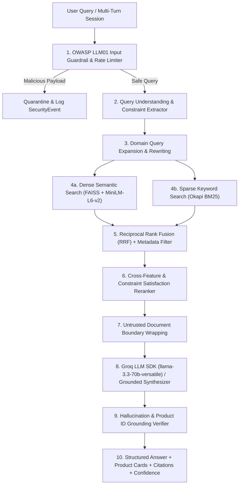

# ShopMind AI — System Architecture & RAG Design Specification

## 1. End-to-End RAG & Agentic Architecture

## 2. Database Schema Separation

Relational data (`PostgreSQL` / `SQLite` fallback) is strictly separated from high-dimensional vector storage (`FAISS` / `data/vector_index/`):

1. `users`: Registered shoppers and administrators with `bcrypt` password hashes and role-based access control (`user`, `admin`).
2. `product_categories`: Normalized product category taxonomy (`Laptops`, `Smartphones`, `Headphones`, `Smartwatches`, `Tablets`, `Monitors`, `Accessories`).
3. `products`: Complete product records with JSON `specifications`, `features`, `product_metadata`, positive price check constraints, and `rating` bounds (`0..5`).
4. `conversations`: Multi-turn shopping sessions preserving `active_constraints` (budget, brand, category, specifications) across follow-up turns.
5. `messages`: Turn-by-turn conversation transcripts with `recommended_products`, `citations`, `retrieval_metadata`, and `confidence_score`.
6. `user_preferences`: Learned shopper preferences (`preferred_categories`, `preferred_brands`, `max_budget`, `required_specs`).
7. `evaluation_runs`: Aggregate metrics for each execution of the 106-question ground-truth benchmark.
8. `evaluation_results`: Question-level retrieval and generation metrics (`precision_at_k`, `recall_at_k`, `mrr`, `ndcg_at_k`, `hit_rate`, `faithfulness`, `answer_relevancy`, `context_precision`, `context_recall`, `response_correctness`, `hallucination_rate`, `passed`, `failure_reason`).
9. `security_events`: Real-time audit stream of blocked prompt injections, indirect document injections, SQLi, XSS, RBAC violations, and invalid JWT attempts.
10. `ingestion_jobs`: Detailed ingestion job history tracking `ingested_count`, `updated_count`, `skipped_duplicates`, `failed_count`, and row-level `error_details`.
11. `audit_logs`: Immutable administrative action audit trail.
